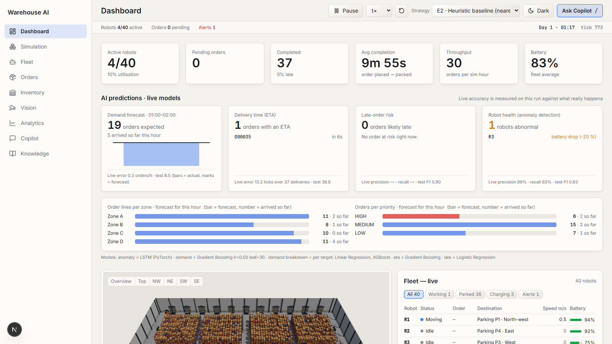
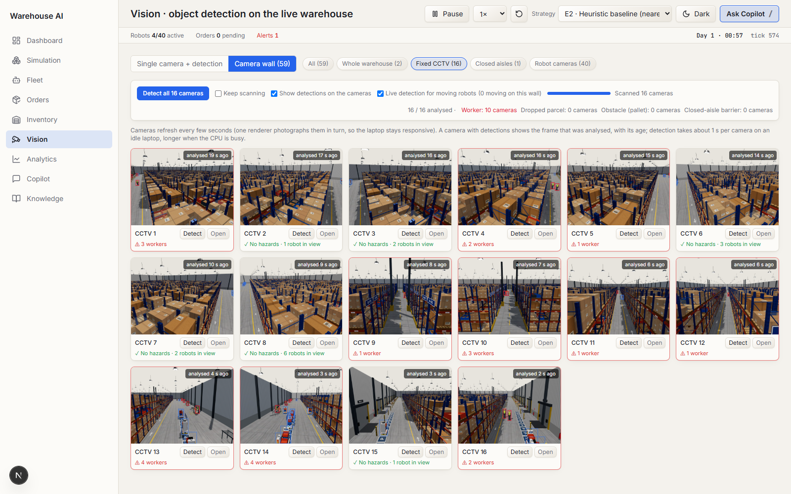
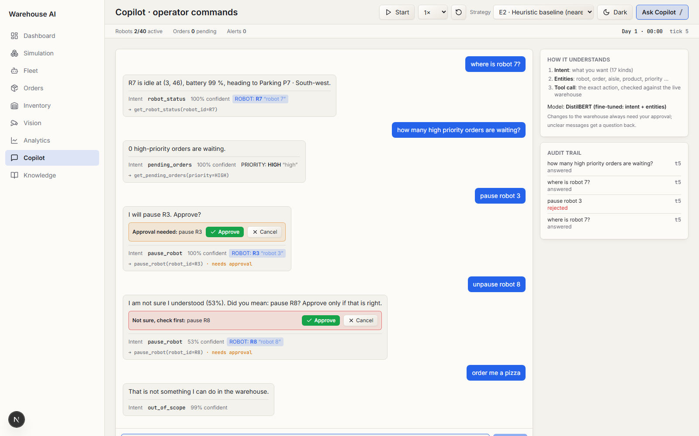
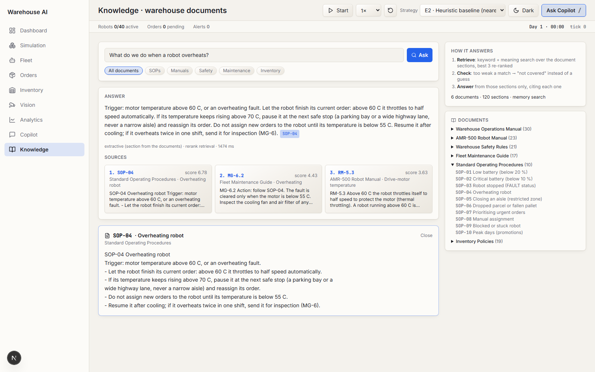
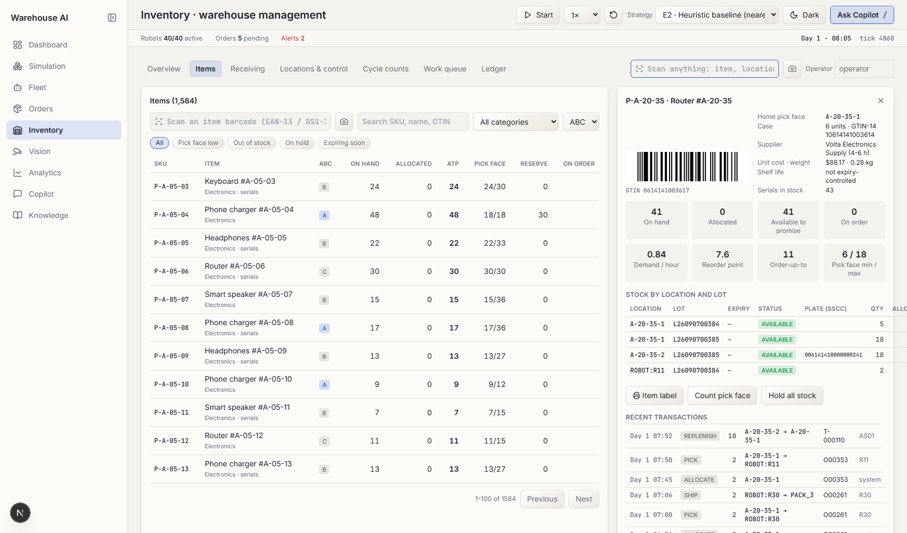

# Warehouse AI Platform

[](https://github.com/shahidwattoo01/ai-warehouse-automation/actions/workflows/ci.yml)

**AI-Powered Autonomous Warehouse Automation & Fleet Intelligence Platform**

A simulated intelligent warehouse — robots, orders, shelves, inventory, workers and packing stations living inside one simulator — with ten AI layers on top: classical ML, deep learning, computer vision, NLP + Transformers, RAG, tool calling, agents and multi-agent coordination, optimization and reinforcement learning. Operators control it through a realistic 3D web Control Center and an AI Operations Copilot.

> Final project — NAVTTC AI/ML training, NetSol Technologies, Lahore.

**Quality and compliance:** every push is linted, tested (unit, API and database tests) and built
by [CI](.github/workflows/ci.yml) · [model cards](docs/model_cards/README.md) for every model ·
[security model](SECURITY.md) · [third-party licences](THIRD_PARTY_LICENSES.md) (note:
Ultralytics YOLO is AGPL-3.0) · exact dependency versions in `requirements.txt`.

---

## Core principles

1. **The simulator is the single source of truth.** Every AI component reads the same `warehouse_state` and changes it only through the simulator's command API.
2. **The simulator generates all training data.** ML, DL, CV and RL models train and evaluate on data from simulator runs.
3. **All ten layers are mandatory.** DL, CV, NLP + Transformers, RAG, agents, multi-agent, optimization and RL are core deliverables.
4. **LLMs act only through tools.** Write actions need operator approval; the backend validates everything.
5. **Baselines first.** Classical ML before neural nets, Dijkstra/A\* before RL — every advanced model is measured against its baseline.

## Architecture

```
Next.js Control Center (React Three Fiber 3D view)
        │  REST /api/v1  +  WebSocket /simulation/stream
        ▼
FastAPI backend ──► Copilot + orchestrator (NLP, LangGraph agents)
        │                 │                     │
        │            AI modules            Tool registry (validation + approval)
        │                 │                     │
        └───────────► Simulator engine (single source of truth) ◄──┘
                          │
          PostgreSQL (+pgvector)      models/ (versioned artefacts)
```

The Python simulator owns the logic (grid, tick loop, robots, orders, events). The browser renders it in **realistic 3D** — PBR glTF models of robots, racking, pallets and stations, HDRI lighting and shadows — driven by the live WebSocket stream.

## Repository layout

| Path | Contents |
| --- | --- |
| `apps/backend/` | FastAPI service: `/api/v1` routers, Pydantic schemas, database, services, WebSocket stream |
| `apps/frontend/` | Next.js + Tailwind Control Center; `components/three/` holds the 3D warehouse scene |
| `simulation/` | Simulator engine: warehouse grid, robots, orders, inventory, navigation, events, camera |
| `ai/` | One package per AI layer, all implementing `ai.common.base.AIModule` |
| `configs/` | Warehouse layouts, simulation settings, experiments E1–E7, model registry config |
| `data/` | `raw/`, `processed/`, `synthetic/` (simulator output) and `documents/` (RAG knowledge base) |
| `models/` | Trained models and their test reports (not in Git; see `models/README.md`) |
| `evaluation/` | Experiment harness and metric reports (ML, RAG, agents, simulation) |
| `notebooks/cloud/` | Colab / Kaggle / Azure GPU training notebooks |
| `scripts/` | Seed, data generation, training and experiment entry points |
| `tests/` | Unit and end-to-end (browser) tests; API and database tests are in `apps/backend/tests/` |
| `docs/` | Phase documents, model cards, architecture decision records |
| `reports/` | **Main project report** (`Project_Progress_Report.pdf`), updated at the end of every phase |

## Quick start

```bash
cp .env.example .env               # then set your own POSTGRES_PASSWORD
docker compose up --build          # postgres + backend + frontend
# Backend:  http://localhost:8000/docs
# Frontend: http://localhost:3000
```

Local development without Docker (Python 3.11, Node 20, PostgreSQL 16 with pgvector):

```bash
python -m venv .venv
.venv\Scripts\activate            # Windows  (macOS/Linux: source .venv/bin/activate)
pip install --extra-index-url https://download.pytorch.org/whl/cpu -r requirements.txt -r requirements-dev.txt
cd apps/frontend && npm ci && cd ../..

python tasks.py migrate   # database schema
python tasks.py seed      # reference data (layout, shelves, robots, products)
python tasks.py backend   # FastAPI with reload  -> http://localhost:8000/docs
python tasks.py frontend  # Next.js dev server    -> http://localhost:3000
```

Trained models are not in Git (see [`models/README.md`](models/README.md)): copy them into
`models/` or retrain them (next section). Without them the app runs, with predictions off.

## Screens

| Dashboard · live 3D warehouse | Vision · camera wall with detections |
| --- | --- |
|  |  |







## Build phases and results

| # | Phase | Status | Result (held-out test data unless noted) |
| --- | --- | --- | --- |
| 1 | Foundation | ✅ | FastAPI + Next.js + PostgreSQL, Docker, CI |
| 2 | Simulator (realistic 3D) + dataset v3 | ✅ | 80 × 50 m warehouse, 40 AMRs, faults and hazards; 91-day dataset |
| 3 | Classical ML | ✅ | ETA MAE 38.8 vs 65.4 baseline · late risk F1 0.90 · demand MAE 8.51 vs 10.34 · faults F1 0.813 |
| 4 | Optimisation | ✅ | Best strategy E4d (Hungarian on predicted ETAs): −21 % delivery time, −40 % late orders, 5/5 days |
| 5 | Deep learning + vision | ✅ | LSTM faults F1 0.835 (14/14 days) · demand networks MAE 7.42 · YOLO11s mAP@0.5 0.908 · Vision page |
| 6 | NLP + Transformers | ✅ | Copilot commands: DistilBERT exact tool call 0.807 vs 0.725 TF-IDF · approval-gated actions · Copilot page |
| 7 | RAG | ✅ | Knowledge assistant: right section in top 3 for 96 % of test questions, first citation right 87 % · Knowledge page |
| 8 | Tools + agents | ⏳ | Copilot that plans and executes approved actions |
| 9 | Multi-agent + RL | ⏳ | RL navigation compared with A\* |
| 10 | Integration | ⏳ | All layers connected end to end |
| 11 | Evaluation (E1–E7) | ⏳ | Progressive experiments on identical seeds |
| 12 | Finalization | ⏳ | Deployment, final report, presentation |

Details: [`docs/phase4_optimization.md`](docs/phase4_optimization.md),
[`docs/phase5_deep_learning_vision.md`](docs/phase5_deep_learning_vision.md), [`docs/phase6_nlp.md`](docs/phase6_nlp.md), [`docs/phase7_rag.md`](docs/phase7_rag.md), inventory management [`docs/wms_inventory.md`](docs/wms_inventory.md), outbound and shipping [`docs/wms_outbound.md`](docs/wms_outbound.md), the beginner's
guide [`docs/phase4_phase5_explained.md`](docs/phase4_phase5_explained.md), and the main report
[`reports/Project_Progress_Report.pdf`](reports/Project_Progress_Report.pdf) (see `reports/README.md`).

## Users and login

Everyone logs in with an account; roles (administrator, supervisor, operator, inventory clerk,
viewer) decide what each person can see and do. First admin:

```bash
cd apps/backend && alembic upgrade head
python scripts/create_user.py --username <you> --name "<Your Name>" --role admin
```

Details: [`docs/authentication.md`](docs/authentication.md).

## Training

The notebooks in `notebooks/` are the training pipelines (they explain every step); one command
runs a notebook end to end and checks the model it writes:

```bash
python scripts/generate_data.py            # dataset v3 -> data/processed/
python scripts/train.py --list             # models, notebooks, current test results
python scripts/train.py --model eta        # or: --phase 3, --model anomaly_lstm, --phase 6, --model rag, ...
python scripts/register_model.py --db      # show models / register them in model_versions
```

Seeds are fixed: retraining reproduces the same models. No local GPU is needed; the YOLO detector
trains on a free Google Colab GPU (`notebooks/cloud/train_yolo_colab.ipynb`, see
[`notebooks/README.md`](notebooks/README.md)).

## Tests and quality

```bash
python tasks.py test                 # unit, API and database tests (database tests skip without PostgreSQL)
python -m pytest tests/e2e           # browser tests against the running app (skip when it is not running)
python tasks.py lint                 # ruff
cd apps/frontend && npm run lint && npm run typecheck
```

CI runs all of this on every push, plus a production build of the frontend, a Docker image check
and dependency vulnerability scans.

See `docs/README.md` for the PRD, TRD, App Flow, UI/UX brief, Backend Schema and Implementation Plan.
