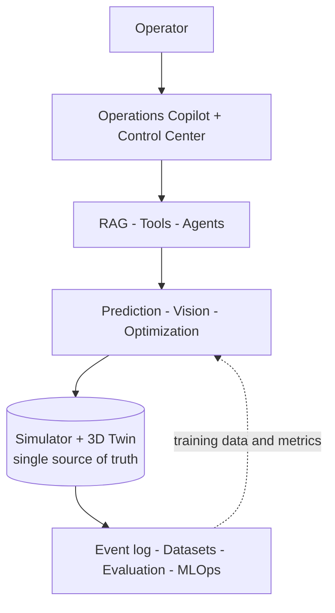

# Warehouse AI Platform

AI-driven warehouse robot fleet intelligence: a deterministic warehouse simulator with a 3D digital twin,
and the AI layers that run on top of it (prediction, optimization, vision, language, retrieval, agents,
reinforcement learning), evaluated against baselines.

> Course project at NetSol Technologies, Lahore. Simulation only; no real robot hardware.

## Architecture in one picture



Rules that hold the system together:

1. The simulator is the single source of truth. AI layers read state and request actions.
2. Every action is validated, policy-gated, optionally human-approved, verified and audited.
3. Same scenario and seed always give the same result.
4. Every layer is evaluated against a baseline; every result is reproducible from a tagged commit.

## Repository layout

| Path | Purpose |
| --- | --- |
| `src/warehouse_ai/` | The Python package: simulation, data, ML, DL, optimization, vision, NLP, RAG, tools, agents, RL, copilot, evaluation, MLOps, API |
| `apps/twin/` | Next.js and Three.js 3D digital twin and control center |
| `assets/` | 3D asset sources, specification, export scripts |
| `configs/` | Simulation, scenario, layout, model, agent and experiment configuration (YAML) |
| `contracts/` | JSON Schemas and golden messages: the interface between services |
| `data/` | Dataset workspace (raw data tracked by DVC), documents, scenarios |
| `orchestration/` | n8n workflows and the mock backend |
| `docker/` | Dockerfiles and Compose files |
| `tests/` | Unit, property, scenario, contract, integration, determinism, data, performance tests |
| `docs/` | Architecture, decisions (ADR), guides, runbook, model and data cards |
| `scripts/` | Command-line entry points |

The full annotated tree is in [docs/STRUCTURE.md](docs/STRUCTURE.md).

## Quick start

```bash
git clone <repo-url> && cd warehouse-ai-platform
make setup          # virtual environment, dependencies, pre-commit hooks
make test           # run the test suite
make api            # start the API at http://localhost:8000/docs
make twin           # start the 3D twin at http://localhost:3000
make up             # or start everything with Docker Compose
```

On Windows, use WSL2 (Ubuntu) and open the folder in VS Code with the WSL extension.

## Build order (10 weeks)

| Weeks | Focus | Gate |
| --- | --- | --- |
| 1 | Simulator core fixed, contracts frozen | G0: below 50 rejected moves per 1,000, deterministic |
| 2 to 3 | Entities, streaming, lean 3D twin, dataset v0.1 | G1 |
| 4 to 6 | ML, deep learning, assignment and A*, vision, replanning | G2 |
| 7 to 8 | NLP, RAG, tools, agents, Copilot | G3 |
| 9 to 10 | RL (advanced), final experiments, hardening, demo | G4 |

## Experiments

Seven modes, each adding one capability: random, nearest, A*, AI-assisted assignment, dynamic replanning,
agentic control, RL. See [docs/experiments/experiment-plan.md](docs/experiments/experiment-plan.md).

## Team and workflow

Three people, building together. See [CONTRIBUTING.md](CONTRIBUTING.md).
