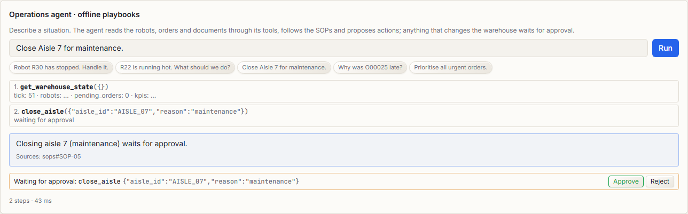

# Phase 8: tools and agents

The operations agent handles situations an operator describes: a stopped or overheating robot,
a robot blocking a lane, a late order, an assignment to a robot that cannot take it, urgent
orders, closing an aisle, or a question about procedures.

* It acts only through typed tools and looks before it acts.
* It follows the SOPs.
* Every change to the warehouse waits for a person's approval.

Code:

* [`ai/agents/tools.py`](../ai/agents/tools.py): the tool registry.
* [`ai/agents/graph.py`](../ai/agents/graph.py): the agent loop.
* [`ai/agents/planner.py`](../ai/agents/planner.py): the planners.
* [`ai/agents/evaluate.py`](../ai/agents/evaluate.py): the evaluation.
* Service: `apps/backend/app/services/agents.py`.
* API: `/api/v1/tools` and `/api/v1/agents/...`.
* The **Operations agent** panel on the Copilot page.

## Tools

The 15 tools of `data/processed/agents/tools.json`. Each has a JSON schema for its arguments, a
read/write flag and an approval flag.

* **Read tools:** `get_robot_status`, `get_pending_orders`, `get_inventory`, `calculate_route`,
  `get_warehouse_state`, `get_events`, `search_knowledge`.
* **Write tools, which need approval:** `assign_order`, `reroute_robot`, `pause_robot`,
  `resume_robot`, `close_aisle`, `open_aisle`, `set_assignment_mode`, `create_order`.

Every call is checked twice before it runs:

* against its schema (`R41`, a missing order id or an unknown reason are refused);
* against the live warehouse (the robot, order, aisle or product must exist; `assign_order` only
  to a robot that can take the order now).

A refused call returns to the planner as an error to act on; it never crashes a run. Results are
structured data.

Write tools become simulator commands, applied at the next tick like an operator's button.
`close_aisle` cannot trap a robot. If robots or picks are still in the aisle, the closure is
scheduled and happens the moment the aisle is clear (SOP-05).



## The loop and the planners

```
request ──► planner: next step? ──► tool call (validated) ──► observation ──┐
              ▲                                                               │
              └───────────────────────────────────────────────────────────────┘
              └──► answer with the SOP / manual sections it followed
```

* **Step budget:** at most 8 tool calls.
* **Approval gate:** in the live platform a write is not run. It becomes a pending action that a
  person approves or rejects. The approver needs `copilot:approve` and the action's own permission
  (for example `robots:command` for closing an aisle), as for the copilot. Approved actions are
  validated again, against the warehouse as it is then. Undecided actions expire after 15 minutes.
* **Live platform:** the knowledge search (about 1 s of CPU) runs in a worker thread. All engine
  access happens between ticks.

### Offline planner (default, no API key)

* It recognises the situation and works through its procedure from the SOPs.
* Every decision comes from what the tools return, not from the wording. "Assign O00146 to R9"
  checks R9 first and gives the order to a free robot if R9 cannot take it.
* A stopped robot is left alone while its fault clears (SOP-03).
* A late order is explained from the events of the order **and** of its robot while it carried
  it.

### Claude planner (`LLM_PROVIDER=anthropic`, `LLM_API_KEY`)

The same 15 tools are offered to Claude through tool use, with the SOP rules in the system prompt.
This handles any wording and situations no playbook covers (backlog PR-21). It uses the same loop,
validation and approvals.

There is no API key here, so it is tested against a scripted stand-in of the API: tool use, the
result sent back, then the final answer. `python scripts/evaluate_agents.py --planner claude`
evaluates it once a key is set.

## Evaluation: 92 situations from the simulator

`python scripts/evaluate_agents.py` (`reports/agents_eval_offline.md` / `.json`) does this for
each scenario:

1. Replays the simulator to the scenario's moment and checks the state fingerprint.
2. Runs the agent with **every write approved**. This is the worst case: a person who approves
   everything does not filter the agent's mistakes.
3. Keeps the warehouse running for 200 ticks, then applies the scenario's checks to what really
   happened. The checks include:
   * the aisle closed only when empty;
   * the robot moved within 30 ticks;
   * no new order for a hot robot until below 55 °C;
   * the order went to an eligible robot;
   * no write actions;
   * the right sources cited.

**Offline planner, 92 scenarios, all replayed to the exact recorded state:**

| Situation | Scenarios | Task success | Required tools | Forbidden calls | Within budget | Avg steps |
|---|---|---|---|---|---|---|
| blocked robot | 12 | 100 % | 100 % | 0 | 100 % | 2.0 |
| close busy aisle | 12 | 100 % | 100 % | 0 | 100 % | 2.0 |
| knowledge question | 10 | 90 % | 100 % | 0 | 100 % | 1.0 |
| late order | 12 | 100 % | 100 % | 0 | 100 % | 2.0 |
| overheating | 12 | 100 % | 100 % | 0 | 100 % | 2.0 |
| stopped robot | 12 | 92 % | 92 % | 0 | 100 % | 2.0 |
| unavailable robot | 12 | 92 % | 0 % | 0 | 100 % | 2.9 |
| urgent queue | 10 | 100 % | 100 % | 0 | 100 % | 1.0 |
| **all** | **92** | **97 %** | **86 %** | **0** | **100 %** | **1.9** |

The three that fail:

* **Unavailable robot, 506.** No robot at all was free, so there was nothing valid to assign the
  order to. The agent says so instead of forcing it.
* **Stopped robot, 507.** The scenario expects the agent to pause the robot and reassign its
  HIGH order. But both items were already in that robot's tote, so another robot cannot take the
  order (the simulator refuses; a person would have to move the tote). The fault also cleared in
  20 ticks with 84 ticks to the deadline. The agent's answer, wait, is the right one here; the
  scenario's reference answer assumed the order could move.
* **Knowledge question, Q062.** The search cited the neighbouring section (MG-3.1 instead of
  MG-3.2). That is retrieval quality (phase 7), not the agent.

**Required tools: 0 % for unavailable robot,** although 11 of 12 succeed. The scenarios expect a
first `assign_order` to the robot the operator named, which the simulator then refuses. The agent
checks that robot first, sees it is charging, skips the doomed call and gives the order to a free
robot. The order still ends up on an eligible robot, which is what the success check measures.

A run takes 1–3 tool calls, well inside every budget. No forbidden tool was called in any
scenario.

## Found on the way

**SOP-04 was not enforced.** The procedure says an overheated robot gets no new orders until it
is below 55 °C. The dispatcher ignored temperature, and nothing the agent may do could enforce it:
pausing a hot robot is forbidden by the same SOP. All 12 overheating scenarios failed for that
reason, even though the agent's advice was right.

* It is now a dispatcher rule (`thermal.no_new_orders_above: 60`, `resume_below: 55`).
* The rule is **off** in the base configuration, so the datasets, models and experiments are
  unchanged (the simulator fingerprint is identical). The live backend switches it on
  (`THERMAL_DISPATCH_LIMIT`, default 60).
* A first version missed robots that overheated while busy: they came free at 58 °C and got a
  new order at once. The temperature is now tracked on every check.

**Questions must never act.** "Can I close Aisle 12 while a robot is picking in it?" was read as
a command, and with every write approved the evaluation actually closed the aisle (Q054). A
question that names no robot or order now always goes to the knowledge search.

**The event tool hid the cause of late orders.** It returned the last 15 events, and a robot's
many reroutes pushed its fault out of view. Two late orders were explained as "traffic" instead
of "a fault on the way". Unusual events (faults, rejections, closures) now always come back,
and the routine ones are counted.

**Reassigning an urgent order off a stopped robot (SOP-03 step 3).**

* Before, the simulator could not move an order that was already assigned.
* Now an operator (or an approved agent action) can move the order of a **paused or faulted**
  robot to another robot, if nothing has been picked yet. The new robot is checked first, so a
  refusal releases nothing.
* The agent pauses the robot and reassigns the order when a stopped robot carries a HIGH order
  whose deadline cannot wait for the fault to clear.
* The automatic dispatcher never uses this, so the simulator fingerprint is unchanged.

## Tests

* `tests/unit/test_agents.py`:
  * the registry and its validation;
  * situation recognition;
  * the approval gate (pending, refused, approved);
  * the busy-aisle and unavailable-robot scenarios end to end;
  * the step limit;
  * errors returned as observations;
  * the Claude tool-use loop against the stand-in.
* `tests/unit/test_reassign_stopped.py`:
  * an order moves off a faulted robot before any pick;
  * a move is refused while the robot runs, or once items are in its tote;
  * SOP-04 with its 60/55 °C hysteresis.
* `apps/backend/tests/test_agents_api.py`:
  * the tool list;
  * a run on the live warehouse with a pending action, approved once and then refused as already
    decided;
  * a rejection;
  * a read-only request;
  * approval needs the action's own permission.

## Not yet

* Claude has not been evaluated here (no API key).
* Several agents working together (supervisor and specialists) are phase 9.
* Knowledge from real, messy documents (PR-22) follows with phase 9's document work.
