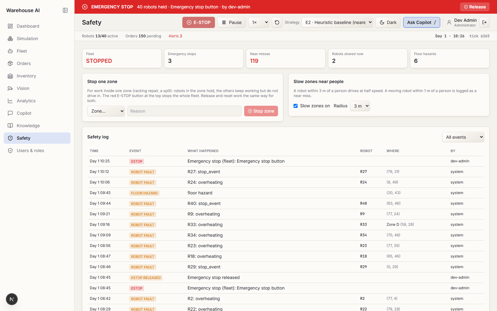

# Fleet safety: emergency stop, slow zones and the safety log

Backlog PR-23. Code: [`simulation/environment/safety.py`](../simulation/environment/safety.py),
API [`apps/backend/app/api/v1/safety.py`](../apps/backend/app/api/v1/safety.py), the **Safety**
page and the red **E-STOP** button in the header of every page.

## 1. What this software does (the supervisory layer)

| Function | Behaviour |
|---|---|
| **Emergency stop (fleet)** | One press of the red E-STOP button, no confirmation. Every robot holds where it is: no driving, no picking or dropping, no new orders. The red banner appears on every page for everyone. Anyone logged in may press it, like the red buttons on the floor. |
| **Zone stop** | For work inside one zone (racking repair, a spill): robots in the zone hold; the rest keep working but wait at the zone's edge instead of driving in. Safety page → *Stop one zone*. |
| **Release** | Clears the stop condition only. Robots keep holding: **releasing never restarts motion** (the ISO 13850 / ISO 3691-4 rule). Banner turns amber. Needs `safety:reset`. |
| **Reset** | The deliberate restart. Refused while a person stands next to a held robot; the person resetting can confirm *area checked, reset anyway* (logged as `RESET_CONFIRMED` under their name), for example when the person is standing clear and aware. Needs `safety:reset`. |
| **Slow zones** | A robot within 3 m (configurable 1-5 m) of a person drives at half speed. On in the live app, off in `configs/simulation.yaml` so recorded datasets and the golden master keep their behaviour (a test checks the safety layer changes nothing when off). |
| **Near misses** | A moving robot within 1 m of a person is logged (once per robot and person per minute). |
| **Safety log** | Emergency stops, releases, resets, confirmed resets, near misses, floor hazards, aisle closures, collisions, robot stop and overheating faults, setting changes: with time, robot, zone and position, and the user. Shown on the Safety page and stored per run in PostgreSQL (`safety_events`, migration 006). |

Roles: everyone may stop; operators, supervisors and administrators may release and reset
(`safety:reset`). Every robot in the Fleet table shows **E-STOP** or **slow** while it applies.

## 2. What it does not do: certified safety lives in the robots

This platform is a fleet manager and a simulation. A real installation relies on safety functions
that are **certified, hardwired or run on safety-rated controllers in each robot and in the
building**, and that keep working when this software, the network or the server fails:

| Standard | Covers | Where it lives |
|---|---|---|
| **ISO 3691-4** (driverless industrial trucks) | Emergency stop circuits, personnel detection (safety laser scanners), speed limits near people, operating zones, braking, warnings | Robot hardware and its safety PLC (performance level per ISO 13849-1, typically PL d) |
| **ANSI/RIA R15.08-1/-2** (industrial mobile robots) | Same scope for North America, plus the integrator's duties for the site | Robot manufacturer and the integrator's risk assessment |
| **ISO 13850** (emergency stop) | Stop category, no automatic restart after release | Physical e-stop buttons on robots and walls, wired to the safety circuit |
| **ISO 13849-1** | Reliability (performance level) of the safety functions | Safety-rated controllers, not application software |

So the software e-stop here is a **supervisory stop**: it tells the fleet to hold (in a real
system over VDA 5050 instant actions, backlog PR-12), it shows everyone the state and it keeps
the audit trail. It is **not** a substitute for the robots' own emergency stop, which must stop
them even if this server is down. Before a real deployment: a site risk assessment by the
integrator, the robots' certification documents, and tests of the physical stops.

## 3. API

`/api/v1/safety`: `GET status` (state, held robots, slowed robots, metrics, people blocking a
reset), `POST estop` (`{reason, zone}`; zone omitted = the whole fleet), `POST release`
(`{note}`), `POST reset` (`{area_checked}`), `PUT settings` (`{slow_zones, slow_radius}`),
`GET events` (`?kind=&severity=`). The live state stream carries `safety` and each robot's
`safety` (`ESTOP`, `SLOW`). Tests: `tests/unit/test_safety.py`,
`apps/backend/tests/test_safety_api.py`, `tests/e2e/test_ui.py` (the real button, release and
reset in a browser).

## 4. Not yet

* Sending the stop to real robots (VDA 5050 `instantActions`: `stopPause`, `startPause`), with
  the robots' acknowledgement shown per robot (PR-12).
* Safety KPIs over time on the Analytics page (near misses per 1,000 robot-hours, stop
  durations) and alert notifications (PR-32).
* Wearables or camera-based person detection feeding the slow zones (today the simulated
  workers' positions are known exactly).
