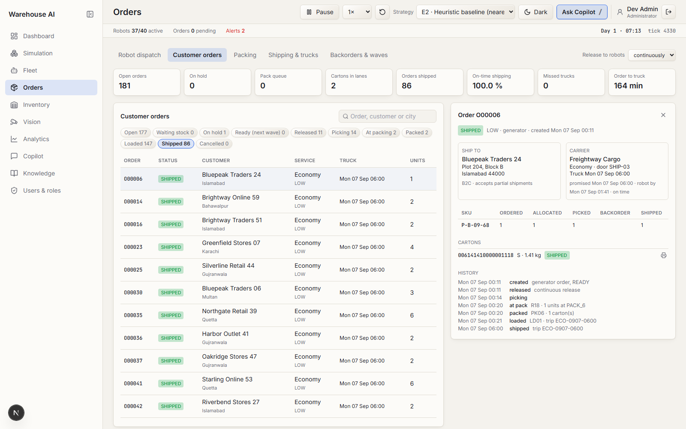
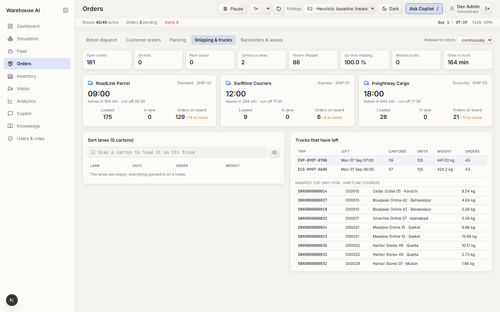

# Outbound: customer orders, packing and shipping

Before this, an order ended when its robot reached a packing station. Now it continues the way it
does in a real warehouse: packed into cartons, weighed, labelled, sorted to its carrier's lane,
loaded onto a trailer, and shipped when the truck leaves on schedule. Customers get holds,
cancellations, partial shipments and backorders. Code: [`wms/outbound.py`](../wms/outbound.py);
design decisions: [ADR 010](adr/010-outbound-flow.md). Backlog items PR-08 and PR-28.



## 1. Master data

| Record | Content |
|---|---|
| **Customer** (60) | Name, B2C / B2B, ship-to address, city and postal code (12 cities), and whether partial shipments are accepted (70 %). Fictitious. |
| **Carrier** (3) | Swiftline Couriers (Express: 07, 12, 17, 22 h), RoadLink Parcel (Standard: 09, 15, 21 h), Freightway Cargo (Economy: 06, 18 h). Each has a shipping door (`SHIP-01..03`) and a sort lane (`LANE-EXP/STD/ECO`). Fictitious. |
| **Carton** | S 6 L / 5 kg, M 18 L / 12 kg, L 40 L / 20 kg, filled to 80 %. Every item has a packed volume (litres per kg by category). |

## 2. The flow

```
order ─► customer + ship-to, carrier by priority (HIGH Express, MEDIUM Standard, LOW Economy)
      ─► promised truck: the first whose cut-off (30 min before departure) is after the
         robot's pick-by deadline + 15 min packing
      ─► WAITING_STOCK / ON_HOLD / READY ─► RELEASED to the robots (continuously or in waves)
      ─► PICKING ─► AT_PACK: the robot drops the order's tote (TOTE-<order>) at a station
      ─► PACK (the station's packer): cartons chosen by volume and weight, SSCC per carton,
         carrier tracking number, weighed: outside ±3 % (min 50 g) → AUDIT, re-check
      ─► sort to LANE-<carrier> ─► LOAD (dock loader) onto the carrier's next truck
      ─► the truck leaves: SHIP (stock leaves the books), manifest, ship confirmation
```

Every step is a ledger transaction (`MOVE` into the tote, `PACK`, `MOVE` to the lane, `LOAD`,
`SHIP`) with the order as reference and the packer, loader or user who did it. The robot's
deadline is unchanged (the prediction models were trained on it); the shipping promise is
derived from it and measured separately: **on-time shipping** = shipped on or before the
promised truck. An order still open when its truck leaves has **missed** it and moves to the
next one.

**Crews:** one packer per packing station and two dock loaders, separate from the eight inbound
associates. Packing, audit, loading and put-back can each be switched to manual (Inventory →
Work queue); the work then waits for a person in the app.

## 3. Exceptions

| Exception | What happens |
|---|---|
| **Hold** | 1 % of new orders wait for a (simulated) credit check, released after 20-90 min; operators can hold any order that is not on a robot yet, with a reason. Held orders are never released to robots. |
| **Cancel** | Before loading. Allocated stock is freed. After packing, a loader **puts the picked units back** on their pick faces (ledger `MOVE` with the order reference). Refused while the order is on a robot, or once loaded. |
| **Partial shipment** | An order waiting for stock longer than 60 min ships what is allocated **if the customer accepts partial shipments**; the rest becomes a **backorder**. Also by hand ("Ship what is in stock"). |
| **Short pick** | Missing units are backordered (customers accepting partials) or noted as shipped short. |
| **Backorder** | When the stock is available again, a follow-up order (`source BACKORDER`, same customer, `parent` = the original) is created in the simulator and picked like any other. |
| **Missed truck** | Counted per order and per departure (alert: "left with N cartons; M orders missed it"). |

## 4. Release: continuous or waves

**Continuous** (default): an order goes to the robots as soon as its stock is allocated, the usual
way for robot fleets. **Waves**: every 10-60 min the ready orders are released together, earliest
truck first (at most 80 per wave); *hot* orders, whose robot deadline comes before the next wave,
go at once. Switch on the Orders page (permission `wms:settings`).

## 5. Labels and barcodes

The **shipping label** (100 × 150 mm PDF) has ship-from and ship-to, carrier and service, carton
*n of N*, the carrier's tracking number as Code 128, the ship-to postal code as GS1-128 `(420)`
for sortation, and the carton's SSCC with its gross weight: `(00) SSCC (3301) weight`. The scan
parser reads the new 3- and 4-digit AIs (`401`, `420`, `3301`) and the lane and door codes.

## 6. The Orders page

Tabs: **Robot dispatch** (as before), **Customer orders** (pipeline counts, search, the order with
ship-to, carrier and truck, lines from ordered to shipped, cartons with their labels, backorders
and full history; hold / release / ship partial / cancel), **Packing** (totes waiting, failed
weight checks with scan-to-audit, packed cartons), **Shipping & trucks** (the next truck of every
carrier with its cut-off, orders on board, cartons in the lanes, scan-to-load, departed trucks
with their manifests), **Backorders & waves**. KPIs above: open orders, on hold, pack queue,
cartons in lanes, orders shipped, on-time shipping, missed trucks, order-to-truck time.



Permissions: `orders:manage` (hold, release, cancel, partial: operators and supervisors),
`wms:ship` (pack, audit, load: inventory clerks and supervisors), `wms:view` to see it.

## 7. Results (one simulated day, large layout)

Seed 7, 24 simulated hours, 40 robots, about 2,050 orders (measured 30 Oct 2026):

| | Continuous release | Waves every 15 min |
|---|---|---|
| Orders shipped on trucks (9 departures) | 1,682 | 1,637 |
| Cartons per order | 1.32 (S 318, M 872, L 1,502) | 1.32 |
| Weight-check failures (audited) | 10 | 13 |
| Units backordered | 24 | 41 |
| Order to truck, average | 214 min | 228 min |
| Orders that missed their truck | 49 | 48 |
| Robot deliveries late (robot deadline) | 23.9 % | 31.5 % |

* **On-time shipping was 100 % of the orders that left that day**, but 49 orders missed their
  truck and had not left when the day ended, so they are not in that figure yet (they count as
  late when they ship; `tests/unit/test_outbound.py` checks this). Over longer runs, read
  on-time shipping together with missed trucks.
* Order to truck is dominated by the truck schedule (a few departures a day), not the robots.
* Waves made robot deliveries later: orders wait for their wave while the robot deadline runs.
  That is why continuous release is the default for this robot fleet.
* Most cartons are L because light, bulky items (apparel, toys) fill volume before weight.

## 8. API

`/api/v1/wms/outbound/...`: `orders` (list, `?status=open|<status>&q=`), `orders/{id}` (detail),
`orders/{id}/hold|release-hold|release|ship-partial|cancel`, `pack`, `audit`, `load` (scan an
SSCC, `LPN…` or a GS1 `(00)` code), `cartons`, `trips`, `trips/{id}` (manifest), `waves`,
`backorders`, `customers`, `carriers`, `confirmations` (what an ERP would receive);
`/api/v1/wms/labels/shipping/{sscc}`; `/api/v1/wms/settings` takes `release_mode` and
`wave_minutes`. Tests: `tests/unit/test_outbound.py`, `apps/backend/tests/test_wms_api.py`,
`tests/e2e/test_ui.py`.

## 9. Not yet

* Carrier choice by cost and service level, rate shopping, multi-parcel consolidation across
  orders of the same customer, dock appointments for carriers.
* ZPL output for thermal printers (PR-30) and a handheld packing screen (PR-29).
* ERP order import and ship-confirmation export (PR-13); the confirmations are already kept.
