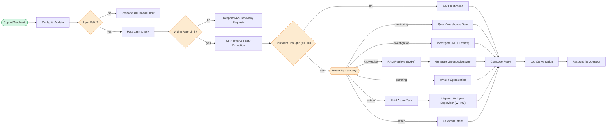
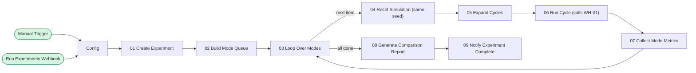
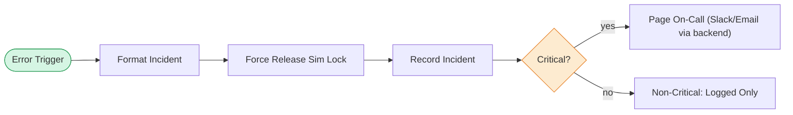
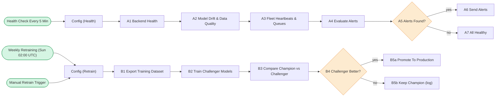

# Workflow maps

How to read: **left to right**. Green = trigger, orange = decision (IF/Switch), blue = reply to caller, yellow = safety guard, grey = code, purple = waits for a human. IF: `yes`/`no` labels on arrows.

## WH-01 Warehouse Orchestrator (Main Loop)

```mermaid
flowchart LR
  N0(["T1 Simulation Tick (30s)"])
  N1(["T2 New Order Webhook"])
  N2(["T3 Run Cycle Webhook (experiments)"])
  N3["Validate Order"]
  N4{"Order Valid?"}
  N5["Respond 202 Accepted"]
  N6["Respond 400 Rejected"]
  N7["Build Run Context"]
  N8["Acquire Sim Lock"]
  N9{"Lock Acquired?"}
  N10["Cycle Skipped (busy)"]
  N11["01 Get Warehouse State"]
  N12["02 Order Processor"]
  N13["03 State & Event Analysis"]
  N14["04 Demand Forecasting"]
  N15["05 ETA Prediction"]
  N16["06 Anomaly Detection"]
  N17["07 Task & Robot Assignment"]
  N18["08 A* / Dijkstra Path Planning"]
  N19{"09 RL Enabled?"}
  N20["09a RL Fleet Coordination"]
  N21["09b RL Guard"]
  N22["10 Safety & Collision Check"]
  N23{"10a Plan Safe?"}
  N24["10b Replan Unsafe Route"]
  N25["10c Replan Loop Guard"]
  N26["11 SimPy Simulation Step"]
  N27{"12 Vision Enabled?"}
  N28["12a Computer Vision Perception"]
  N29["12b Vision Guard"]
  N30["13 Update Warehouse State"]
  N31["14 Telemetry & Event Collector"]
  N32["15 Evaluation Engine"]
  N33{"16 Agents Enabled?"}
  N34["16a Agent Monitor"]
  N35{"16b Action Required?"}
  N36["16c Dispatch Agent Task (WH-02)"]
  N37["17 Persist Cycle (PostgreSQL)"]
  N38["18 Publish Dashboard Update"]
  N39["19 Monitoring Heartbeat"]
  N40["20 Release Sim Lock"]
  N41["21 Cycle Summary"]
  N1 --> N3
  N3 --> N4
  N4 -->|yes| N5
  N4 -->|no| N6
  N0 --> N7
  N2 --> N7
  N5 --> N7
  N7 --> N8
  N8 --> N9
  N9 -->|yes| N11
  N9 -->|no| N10
  N11 --> N12
  N12 --> N13
  N13 --> N14
  N14 --> N15
  N15 --> N16
  N16 --> N17
  N17 --> N18
  N18 --> N19
  N19 -->|yes| N20
  N19 -->|no| N22
  N20 --> N21
  N21 --> N22
  N22 --> N23
  N23 -->|yes| N26
  N23 -->|no| N24
  N24 --> N25
  N25 --> N22
  N26 --> N27
  N27 -->|yes| N28
  N27 -->|no| N30
  N28 --> N29
  N29 --> N30
  N30 --> N31
  N31 --> N32
  N32 --> N33
  N33 -->|yes| N34
  N33 -->|no| N37
  N34 --> N35
  N35 -->|yes| N36
  N35 -->|no| N37
  N36 --> N37
  N37 --> N38
  N38 --> N39
  N39 --> N40
  N40 --> N41
  classDef trig fill:#d5f5e3,stroke:#2E9E5B
  classDef dec fill:#fdebd0,stroke:#E67E22
  classDef guard fill:#fcf3cf,stroke:#F1C40F
  class N0,N1,N2 trig
  class N4,N9,N19,N23,N27,N33,N35 dec
  class N21,N25,N29 guard
```

## WH-02 Agent Supervisor (Multi-Agent + Human Approval)

```mermaid
flowchart LR
  N0(["Agent Task Webhook"])
  N1["Config"]
  N2{"Task Valid?"}
  N3["Respond 202 Accepted"]
  N4["Respond 400 Rejected"]
  N5["01 Planner Agent"]
  N6["02 Split Plan Steps"]
  N7["03 Invoke Specialist Agent"]
  N8["04 Normalize Agent Result"]
  N9["05 Aggregate Results & Actions"]
  N10["06 Policy & Risk Gate"]
  N11{"06a Any Allowed Actions?"}
  N12["R1 Report: No Action"]
  N13{"07 Approval Required?"}
  N14["07a Request Human Approval"]
  N15["07b Wait For Approval"]
  N16{"07c Approved?"}
  N17["R2 Report: Rejected or Timed Out"]
  N18["08 Controlled Tool Executor"]
  N19["09 Verify Agent Action"]
  N20{"09a Verified?"}
  N21["10 Commit Verified Action"]
  N22["10b Rollback Action"]
  N23["R3 Report: Applied"]
  N24["R4 Report: Rolled Back"]
  N25["11 Log & Publish Agent Result"]
  N0 --> N1
  N1 --> N2
  N2 -->|yes| N3
  N2 -->|no| N4
  N3 --> N5
  N5 --> N6
  N6 --> N7
  N7 --> N8
  N8 --> N9
  N9 --> N10
  N10 --> N11
  N11 -->|yes| N13
  N11 -->|no| N12
  N13 -->|yes| N14
  N13 -->|no| N18
  N14 --> N15
  N15 --> N16
  N16 -->|yes| N18
  N16 -->|no| N17
  N18 --> N19
  N19 --> N20
  N20 -->|yes| N21
  N20 -->|no| N22
  N21 --> N23
  N22 --> N24
  N12 --> N25
  N17 --> N25
  N23 --> N25
  N24 --> N25
  classDef trig fill:#d5f5e3,stroke:#2E9E5B
  classDef dec fill:#fdebd0,stroke:#E67E22
  classDef guard fill:#fcf3cf,stroke:#F1C40F
  class N0 trig
  class N2,N11,N13,N16,N20 dec
```

## WH-03 Operations Copilot (NLP + RAG + Actions)

## WH-04 RAG Knowledge Ingestion

```mermaid
flowchart LR
  N0(["Manual Trigger"])
  N1(["Nightly 02:00 UTC"])
  N2(["Document Upload Webhook"])
  N3["Config"]
  N4["01 List New or Changed Documents"]
  N5{"Any Documents?"}
  N6["Nothing To Ingest"]
  N7["02 Split Documents"]
  N8["03 Extract Text"]
  N9["04 Chunk Text"]
  N10["05 Generate Embeddings"]
  N11["06 Upsert To Vector DB (Qdrant/pgvector)"]
  N12["07 Mark Document Indexed"]
  N13["08 Summarize Ingestion"]
  N14["09 Retrieval Quality Gate (golden questions)"]
  N15{"Quality OK?"}
  N16["10a Log Ingestion Success"]
  N17["10b ALERT RAG Quality Degraded"]
  N0 --> N3
  N1 --> N3
  N2 --> N3
  N3 --> N4
  N4 --> N5
  N5 -->|yes| N7
  N5 -->|no| N6
  N7 --> N8
  N8 --> N9
  N9 --> N10
  N10 --> N11
  N11 --> N12
  N12 --> N13
  N13 --> N14
  N14 --> N15
  N15 -->|yes| N16
  N15 -->|no| N17
  classDef trig fill:#d5f5e3,stroke:#2E9E5B
  classDef dec fill:#fdebd0,stroke:#E67E22
  classDef guard fill:#fcf3cf,stroke:#F1C40F
  class N0,N1,N2 trig
  class N5,N15 dec
```

## WH-05 Experiment Runner (Baseline to RL)

## WH-06 Global Error Handler

## WH-07 MLOps (Health, Drift, Retraining)

